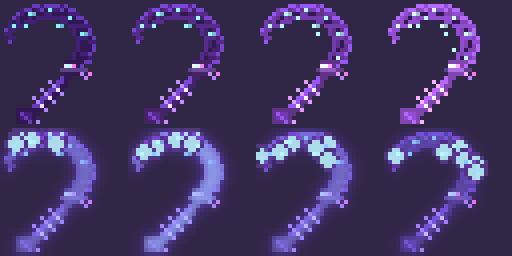
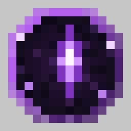

# Goety Arcana（诡厄奥术）

一个 **Minecraft 1.20.1 / Forge 47.x** 的 [诡厄巫法 (Goety)](https://www.mcmod.cn/class/7635.html) 附属模组。
定位是「**Goety 的奥术扩展**」：聚晶只是开始，之后会做聚晶以外的物品，也不限于虚空系。

当前内容（2 件）：

| 虚空镰刀（常态 / 满蓄） | 裂魂聚晶 |
| --- | --- |
|  |  |

- **裂魂聚晶 (Soul Burst Focus)**：虚空系聚晶，射出虚空方块，造成固定 + 最大生命值百分比伤害。
- **虚空镰刀 (Void Scythe)**：末地仪式合成的 360° 镰刀武器，有专属的挥砍/双手蓄力动作，蓄力释放可穿透生物、穿墙飞行的剑气，并施加虚空之蚀与处决。

---

## 一、虚空镰刀


模型以 **第一版虚空镰刀** 的厚月牙轮廓为主体，融合 Goety **死神之镰（death_scythe）** 的 32×32 紧凑握持尺寸与 `goety:item/scythe` 模型父级：保留第一版厚刀身/亮紫刀锋，同时把骨质/蓝色替换为虚空紫与荧光青，并加入死神之镰式护手宝石。刀身光环为 **16 帧、插值过渡** 的 32×512 动画；透明像素填成紫色 RGB，减轻光影/ mipmap 造成的黑边。手持时使用自制 **虚空火** 粒子：每 tick 连续发射、双股反向环绕。

### 面板

| 属性 | 数值 |
| --- | --- |
| 攻击伤害 | **13 点**（6.5 颗心） |
| 攻击速度 | **0.9**（约 1.11 秒一次） |
| 攻击范围 | **360°**，水平半径 4.5 格 |
| 耐久 | 2031 |
| 获取方式 | **末地仪式**：中央黑暗镰刀（`goety:dark_metal_scythe`），外围 2× 虚空回响 + 2× 觉醒绿宝石；12 秒、每秒 5 灵魂 |

### 左键：360° 横扫

- 左键会取消原版单体攻击，对玩家周围 **360°、半径 4.5 格**内的所有合法敌人各结算一次伤害。
- 背后的、侧面的、空中的敌人都能打到。
- **专属挥砍动作**：第三人称下双臂从右后方抬起、横向扫向左前方，躯干同步扭转、头部反向补偿；动作以原版姿势为底叠加，走路/潜行时不会穿模，挥砍结束平滑淡出。第一人称下额外给镰刀一个横向甩动。
- 命中时产生两层 360° **虚空火环**（外圈 4.1 格 + 内圈 1.8~3.5 格），全部使用自制 `goetyarcana:void_flame`，不再混用原版 SWEEP_ATTACK，并播放挥砍音效。
- 每个被命中的目标独立判定：
  - **70%** 施加 **虚空之蚀 I**（5 秒）；
  - **30%** 施加 **虚空之蚀 II**（5 秒）；
  - **5%** 施加 **处决**（5 秒）。
- 不误伤玩家、施法者盟友、宠物、盔甲架、已死亡或无敌目标；中立生物只有已经对玩家产生敌意时才会被扫到。

> 虚空之蚀复用 Goety 的 `goety:void_touched`，I / II 级对应 amplifier 0 / 1。

### 右键：双手蓄力，穿透剑气

- 按住右键蓄力，松开释放。**最低 5 tick（0.25 秒）**可释放，**30 tick（1.5 秒）**蓄满。
- **专属双手蓄力动作**：第三人称下双臂抬到胸前、左手向内夹住镰柄，身体微微前倾；蓄力越高收得越紧，并有轻微颤抖。动作平滑淡入淡出，不替换原版行走/潜行动画。第一人称下镰刀会随蓄力略微向身体中线收拢。
- 蓄力过程有四档刀身模型（普通 → 微光 → 强光 → 满蓄发光）；粒子从外圈螺旋收束到胸口，满蓄时额外出现向外扩散的脉冲环。
- 松开后沿准星方向生成一道 **向前飞行的横向剑气**（`goetyarcana:scythe_wave`）：刃面垂直于飞行方向、横向铺开，贴图本身就是横向刃形（白紫刃芯 + 青色刃缘），不再当广告牌面向镜头。
- **平滑运动**：起飞 4 tick 平滑加速、消散前 12 tick 平滑减速，位置与朝向都做 tick 间插值；出现时淡入、寿命末尾淡出，不会突兀闪现或一帧一跳。
- 与死神之镰剑气一样 **穿透生物**，并且 **不碰撞方块、可穿墙**，直到 5 秒寿命结束。

| 蓄力 | 剑气宽度 | 剑气高度 | 伤害 |
| --- | --- | --- | --- |
| 最低 | 3.0 格 | 1.6 格 | 目标最大生命值 × **5%** |
| 50% | 5.0 格 | 2.3 格 | 目标最大生命值 × **10%** |
| 满蓄 | **7 格** | **3 格** | 目标最大生命值 × **15%** |

- **没有基础伤害**，只有目标最大生命值百分比；伤害类型 `goetyarcana:void_wave` 带 `bypasses_armor` / `bypasses_effects` / `bypasses_enchantments`，让百分比尽量精确，但 **不带** `bypasses_invulnerability`，所以不会绕过 Boss 的常规限伤。
- 剑气速度 **1.0 格/tick**（实际位移受起飞/消散曲线影响），寿命 **100 tick（5 秒）**；每个被扫到的目标只结算一次，命中后剑气继续向前飞，不会消失。
- 命中判定使用“上一 tick 位置 + 当前 tick 位置”的扫掠 AABB，宽度/高度随蓄力提升；高速飞行也不会从目标身上“跳帧穿过”。
- 剑气是纯能量，不破坏作物/草/花，也不会点燃方块。
- 命中时同样有 **5%** 概率施加处决；每个目标命中会爆出一团虚空火。
- 释放后物品冷却 25 tick。

### 处决（Execution）

自行注册的 debuff（`goetyarcana:execution`），持续 **5 秒**。持续时间结束时会先播放 **专属处决动画**：一把巨型虚空镰刀在目标身上斩下，伴随虚空火与月牙斩击；动画蓄势 **12 tick** 后再结算：

| 目标等级 | 结果 |
| --- | --- |
| 普通敌人 | 动画后 **立即消灭** |
| 精英怪 | 损失 **10% 最大生命值** |
| Boss | 损失 **20% 最大生命值** |

- 动画由 `ExecutionSlashEntity` + `ExecutionSlashRenderer` 实现，实际 kill/hurt 延迟到动画高潮（`EXECUTION_ANIMATION_TICKS`）。
- 精英/Boss 伤害使用 `goetyarcana:execution`，同时登记进 `bypasses_armor` / `bypasses_effects` / `bypasses_enchantments` 与 `bypasses_invulnerability`，因此可以绕过 Goety 的 Boss 伤害上限和常规减伤。
- 普通怪使用 `kill()` 直接消灭，不会被各种减伤/限伤救回来；处决动画在结算前播放，结算后动画还会继续淡出。
- 处决来源会记录施加者 UUID，Boss/精英结算时尽量把伤害归给该玩家。
- 处决致死的怪物会播放专属「虚空湮灭」死亡动画（20 tick）：身体被虚空抬起、旋转、压扁并沉入地面，由客户端 `ExecutionDeathAnimation` 接管渲染。
- 判定顺序：实体类型标签 `goetyarcana:bosses` / `goetyarcana:elites` → 原版 Boss → Goety `common.entities.boss` 包 → 最大生命值兜底（≥200 Boss，≥60 精英）。
- 整合包可以通过数据包给其它模组的 Boss/精英加标签，或给实体加 `goetyarcana:elite` scoreboard tag / `goetyarcana:elite=true` persistent data。

### 获取：末地仪式

虚空镰刀由 **Goety 末地仪式（End Ritual）** 合成：

- 中央祭品：**黑暗镰刀**（`goety:dark_metal_scythe`）；
- 外围祭品：**2× 虚空回响**（`goety:void_echo`）+ **2× 觉醒绿宝石**（`goety:magic_emerald`）；
- 仪式时间：**12 秒**；灵魂消耗：**每秒 5**（合计约 60）。

配方文件：`data/goetyarcana/recipes/void_scythe.json`。

### 黑暗秘典

在诡厄巫法的《黑暗秘典》里新增了一个顶层分类 **「诡厄奥术 / Goety Arcana」**，图标为虚空镰刀，目前收录：

- **虚空镰刀**：介绍、末地仪式配方、虚空之蚀/处决说明；
- **裂魂聚晶**：介绍与末地仪式配方（从 Goety 虚空聚晶分类移入本分类）；
- **虚空弩（规划中）**：仅设计文本，尚未实装；
- **虚空爆破聚晶 / 藤蔓缠绕聚晶 / 虚空护身符（规划中）**：仅占位文本，尚未实装。

分类/条目位于 `assets/goety/patchouli_books/black_book/{en_us,zh_cn}/...`。

### 创造模式标签页


新增独立标签页 **「诡厄奥术 / Goety Arcana」**，图标为虚空镰刀；目前收纳本模组全部物品：

- 虚空镰刀
- 裂魂聚晶

旧版把裂魂聚晶放进 Goety「聚晶」页的逻辑仍然保留；两个标签页都能找到它。

---

## 二、规划中的内容（仅文本，占位）

以下内容目前只有设定文本，没有物品、模型、配方或实际机制，已写入《黑暗秘典》的「诡厄奥术」分类，作为后续更新占位。

### 虚空弩 (Void Crossbow)

- 定位：远程虚空武器，发射充能虚空弩矢；
- 命中后短暂留下虚空裂隙，对经过的敌人施加虚空之蚀；
- 蓄力/装填与灵魂能量的具体数值待定。

### 虚空爆破聚晶 (Void Blast Focus)

- 召唤虚空苦力怕仆从，右键清除。

### 藤蔓缠绕聚晶 (Vine Entangle Focus)

- 发射种子，随后对 3×3 范围内怪物的脚下召唤藤蔓，拖住它们的行动。

### 虚空护身符 (Void Amulet)

- 暂不写介绍，仅保留名称占位。

---

## 三、裂魂聚晶（旧内容）

- 固定伤害：**6 点**（3 颗心）
- 百分比伤害：目标**最大生命值 × 7.5%**
- 灵魂能量消耗：**35**
- 吟唱：10 tick（0.5 秒），冷却：**30 tick（1.5 秒）**
- 射弹：**虚空方块**（暗紫岩面 + 发光裂纹 + 顶面符文），匀速 3.6 格/tick，从准星飞出，
  翻滚 + 紫色拖尾，全程紫色粒子
- 学派：**虚空（VOID）**，任意法杖都能施放
- 伤害类型 `goetyarcana:soul_burst` 登记进 `#minecraft:bypasses_invulnerability`，
  **不受 Goety 的 Boss 伤害上限削减**
- **虚空魔杖（`goety:void_staff`）专属**：
  1. 命中附加 **5 秒「虚空之蚀」**；
  2. **夺取目标身上所有正面效果**转移给施法者；
  3. 命中点周围 3 格 **50% 范围伤害**，带两圈扩散粒子环 + 中心闪光 + 呼啸音效；
  4. **空爆**：没打中敌人也会炸——撞到方块、或飞到寿命尽头时，同样触发范围伤害与特效
     （每个目标按「固定 + 自身最大生命值 7.5%」的一半结算）。

> 例：20 血小怪吃 6 + 1.5 = 7.5 点；100 血精英吃 13.5 点；300 血 Boss 吃 28.5 点（不打折）。

---

## 四、工程结构

```
goety-soulburst/                     # 目录名保留旧名，工程内容已是 Goety Arcana
├─ build.gradle / gradle.properties / settings.gradle
├─ README.md
├─ docs/
│  ├─ void_scythe_preview.png         # 虚空镰刀（常态 / 满蓄）
│  ├─ soul_burst_focus_preview.png
│  ├─ soul_burst_projectile_preview.png
│  ├─ GoetyArcana-1.9.6-项目整理.md   # 项目整理文档
│  └─ GoetyArcana-1.9.6-项目整理.docx # Word 版
└─ src/main/
   ├─ java/com/goetyarcana/
   │  ├─ GoetyArcanaMod.java          # 模组入口（mod id: goetyarcana）
   │  ├─ VoidScytheBalance.java       # ★ 虚空镰刀所有数值
   │  ├─ SoulBurstBalance.java        # ★ 裂魂聚晶所有数值
   │  ├─ registry/
   │  │  ├─ ModItems.java             # 裂魂聚晶 + 虚空镰刀
   │  │  ├─ ModEntities.java          # 灵魂弹 + 镰刀剑气
   │  │  ├─ ModEffects.java           # 处决
   │  │  ├─ ModParticles.java         # 自制虚空火粒子类型
   │  │  ├─ ModCreativeTabs.java      # 新的「诡厄奥术」创造页
   │  │  ├─ ModDamageTypes.java       # void_wave / execution
   │  │  └─ ModTags.java              # bosses / elites 实体标签
   │  ├─ item/
   │  │  ├─ SoulBurstFocus.java
   │  │  ├─ VoidScytheItem.java       # 13/0.9、右键蓄力、松开剑气
   │  │  └─ VoidScytheTier.java
   │  ├─ combat/
   │  │  ├─ ScytheCombat.java         # 360° 近战、虚空之蚀、处决触发
   │  │  ├─ CombatTier.java           # 普通/精英/Boss 分级
   │  │  └─ CombatUtil.java           # 目标筛选
   │  ├─ effect/ExecutionEffect.java  # 处决 debuff 结算
   │  ├─ entity/
   │  │  ├─ SoulBurstEntity.java
   │  │  ├─ ScytheWaveEntity.java     # 向前飞行、穿透、穿墙的剑气与扫掠判定
   │  │  └─ ExecutionSlashEntity.java # 处决动画载体
   │  ├─ event/ScytheEvents.java      # 左键实体/方块/空挥入口
   │  ├─ network/ModNetwork.java      # 空挥发包
   │  ├─ spell/SoulBurstSpell.java
   │  ├─ mixin/HumanoidModelMixin.java # 第三人称挥砍/双手蓄力动作
   │  └─ client/
   │     ├─ ClientEvents.java         # 渲染器、粒子提供器、charge 模型属性
   │     ├─ VoidScytheClientEvents.java # 平滑环绕/蓄力粒子
   │     ├─ VoidFlameParticle.java    # 自制虚空火粒子
   │     ├─ ExecutionSlashRenderer.java # 处决巨型镰刀动画
   │     ├─ ExecutionDeathAnimation.java # 处决死亡「虚空湮灭」动画
   │     └─ ScytheWaveRenderer.java   # 横向剑气渲染
   └─ resources/
      ├─ META-INF/mods.toml
      ├─ goetyarcana.mixins.json      # 客户端 Mixin 配置
      ├─ goetyarcana.refmap.json      # 生产环境 SRG 映射
      ├─ assets/goetyarcana/
      │  ├─ lang/{en_us,zh_cn}.json
      │  ├─ particles/void_flame.json
      │  ├─ models/item/void_scythe*.json
      │  └─ textures/{item,entity,particle}/...
      ├─ assets/goety/patchouli_books/black_book/... # 裂魂聚晶手册
      └─ data/
         ├─ goetyarcana/damage_type/{soul_burst,void_wave,execution}.json
         ├─ goetyarcana/tags/entity_types/{bosses,elites}.json
         ├─ goetyarcana/recipes/soul_burst_focus.json
         └─ minecraft/tags/damage_type/{bypasses_armor,bypasses_effects,bypasses_enchantments,bypasses_invulnerability}.json
```

## 五、怎么构建

```bash
gradle build      # 产物 build/libs/goetyarcana-1.9.7.jar
```

需要 JDK 17；Goety 版本在 `gradle.properties` 的 `goety_version`（默认 `2.5.60.6`）。

## 六、想改数值？

### 虚空镰刀

`src/main/java/com/goetyarcana/VoidScytheBalance.java`：

| 常量 | 含义 | 默认 |
| --- | --- | --- |
| `ATTACK_DAMAGE` | 面板伤害 | 13.0F |
| `ATTACK_SPEED` | 面板攻速 | 0.9F |
| `MELEE_RADIUS` | 360° 横扫半径 | 4.5 |
| `MELEE_HEIGHT` | 横扫垂直容差 | 2.5 |
| `VOID_EROSION_TICKS` | 虚空之蚀时长 | 100 tick |
| `VOID_EROSION_I_CHANCE` | 虚空之蚀 I 概率 | 0.70F |
| `EXECUTION_CHANCE` | 处决概率 | 0.05F |
| `EXECUTION_TICKS` | 处决 debuff 时长 | 100 tick |
| `EXECUTION_ANIMATION_TICKS` | 处决动画蓄势/延迟结算 | 12 tick |
| `EXECUTION_DEATH_TICKS` | 处决致死后的死亡动画时长 | 20 tick |
| `EXECUTION_ELITE_PERCENT` | 精英处决伤害 | 0.10F |
| `EXECUTION_BOSS_PERCENT` | Boss 处决伤害 | 0.20F |
| `MIN_CHARGE_TICKS` | 最短可释放蓄力 | 5 tick |
| `FULL_CHARGE_TICKS` | 蓄满时间 | 30 tick |
| `WAVE_LIFETIME` | 剑气寿命 | 100 tick（5 秒） |
| `WAVE_SPEED` | 剑气速度 | 1.0 格/tick |
| `WAVE_MIN_WIDTH` / `WAVE_MAX_WIDTH` | 剑气宽度 | 3 / 7 格 |
| `WAVE_MIN_HEIGHT` / `WAVE_MAX_HEIGHT` | 剑气高度 | 1.6 / 3 格 |
| `WAVE_LAUNCH_TICKS` / `WAVE_DISSIPATE_TICKS` | 起飞加速 / 末尾减速 | 4 / 12 tick |
| `WAVE_LAUNCH_SPEED` / `WAVE_END_SPEED` | 起飞 / 消散速度倍率 | 0.5 / 0.75 |
| `WAVE_MIN_PERCENT` / `WAVE_MAX_PERCENT` | 剑气百分比 | 5% / 15% |
| `WAVE_HIT_DEPTH` | 剑气扫掠判定厚度 | 1.25 格 |
| `WAVE_COOLDOWN_TICKS` | 剑气冷却 | 25 tick |

### 裂魂聚晶

`src/main/java/com/goetyarcana/SoulBurstBalance.java`：

| 常量 | 含义 | 默认 |
| --- | --- | --- |
| `FIXED_DAMAGE` | 固定伤害 | 6.0F |
| `PERCENT_OF_MAX_HEALTH` | 最大生命值百分比 | 0.075F |
| `POTENCY_BONUS` | 每级「强效」额外固定伤害 | 1.0F |
| `SOUL_COST` | 灵魂能量消耗 | 35 |
| `CAST_DURATION` | 吟唱 tick | 10 |
| `COOLDOWN` | 冷却 tick | 30 |
| `PROJECTILE_SPEED` | 射弹速度（格/tick） | 3.6 |
| `SPAWN_OFFSET` | 出生点沿视线前移 | 0.6 |
| `VOID_AOE_RADIUS` | 范围伤害半径 | 3.0 |
| `VOID_AOE_MULTIPLIER` | 范围伤害倍率 | 0.5F |
| `PROJECTILE_LIFETIME` | 射弹存活 tick | 60 |

## 七、实现要点

1. **360° 近战**：`ScytheEvents` 取消 `AttackEntityEvent` / `LeftClickBlock`，由 `ScytheCombat` 对 AABB 内所有合法目标逐个 `hurt`；空挥由 `ModNetwork` 发包到服务端。
2. **专属动作**：`HumanoidModelMixin` 注入 `HumanoidModel#setupAnim` 末尾叠加手臂/躯干旋转（玩家模型的 `super.setupAnim` 之后会自动复制袖子/外套，避免覆盖层错位）；左键读取 `getAttackAnim()` 做横扫，右键读取 `getTicksUsingItem()` 做双手蓄力。第一人称由 `VoidScytheClientEvents#onRenderHand` 提供小幅横向甩动/收拢。Mixin 配置在 `goetyarcana.mixins.json`，生产环境用 `goetyarcana.refmap.json` 映射到 SRG。
3. **蓄力**：`VoidScytheItem#use` 开始使用，`releaseUsing` 按使用 tick 计算 charge；沿玩家视线生成 `ScytheWaveEntity`。
4. **横向穿透剑气**：`ScytheWaveEntity` 每 tick 沿速度方向前进，并用 smoothstep 曲线在起飞/消散阶段平滑加减速，`noPhysics` 保证穿墙；渲染按实体朝向把横向刃面转到垂直飞行方向，命中盒取“上一 tick 位置 + 当前 tick 位置”的并集，用 `Set<UUID>` 保证每个目标只结算一次，命中后不消失。
5. **百分比伤害**：剑气伤害 = `目标最大生命值 × Mth.lerp(charge, 5%, 15%)`，没有固定值；`void_wave` 只带 `bypasses_armor`。
6. **处决**：`ExecutionEffect` 在 effect 最后一 tick 结算；普通怪 `kill()`，精英/Boss 用带 `bypasses_invulnerability` 的 `execution` 伤害类型；结算致死时向 96 格内客户端发送 `ExecutionDeathPacket`，由 `ExecutionDeathAnimation` 接管 20 tick 的「虚空湮灭」死亡动画。
7. **模型/动画**：以死神之镰的 32×32 轮廓为底，使用 `goety:item/scythe` 模型父级；四档刀身贴图 + `layer1/layer2` 的 16 帧插值光环。`charge` predicate 在四个阈值切换模型，实现蓄力变亮。
8. **自制虚空火**：`ModParticles` 注册 `goetyarcana:void_flame`，`VoidFlameParticle` + 4 帧自制贴图；替代原版灵魂火，用于环绕、蓄力、剑气拖尾和命中爆发。
9. **创造页**：`ModCreativeTabs` 注册 `goetyarcana:main`，`displayItems` 显式加入全部本模组物品。

## 八、注意事项

- 虚空镰刀**没有配方**，仅创造模式获取；这是按需求刻意为之。
- 虚空之蚀是 Goety 的 `goety:void_touched`；需要 Goety 2.5.x。
- Boss 限伤绕过依赖 `minecraft:bypasses_invulnerability` 伤害类型标签；如果其它模组也有自己的硬限伤逻辑，可能仍需兼容。
- 剑气伤害是“目标最大生命值百分比”，对高血 Boss 收益高；如果觉得过强，改 `VoidScytheBalance` 即可。
- 伤害只在服务端结算；客户端只负责模型、粒子和剑气渲染。
- 前置：Forge 47.x + Goety 2.5.x（Curios / Patchouli）。
- 工程目录名为 `goety-soulburst` 是历史遗留，mod id 是 `goetyarcana`。

## 九、更新记录

**1.9.7**
- 剑气改为 **横向刃面**（垂直于飞行方向铺开），只采样贴图里刃形所在的条带，避免透明留白把刃身压扁；
- 剑气加入 **平滑运动**：起飞 4 tick 加速、消散前 12 tick 减速，位置/朝向做 tick 间插值，出现淡入、末尾淡出；
- 被处决 debuff 致死的怪物新增 **专属死亡动画**（20 tick 虚空湮灭：抬起、旋转、压扁、沉入地面）；
- 《黑暗秘典》与 README 新增 **虚空爆破聚晶**、**藤蔓缠绕聚晶**、**虚空护身符** 的占位文本。

**1.9.6**
- 左键横扫粒子统一为自制虚空火双层环，移除原版 SWEEP_ATTACK；
- 虚空镰刀新增末地仪式配方：黑暗镰刀（`goety:dark_metal_scythe`）+ 2 虚空回响 + 2 觉醒绿宝石，12 秒 / 每秒 5 灵魂；
- 《黑暗秘典》新增「诡厄奥术」顶层分类，收录虚空镰刀说明与仪式页；
- 新增虚空弩的纯文本设定（黑暗秘典 + README），不包含物品/模型/配方；
- 裂魂聚晶条目移入「诡厄奥术」分类，与虚空镰刀/虚空弩集中展示。

**1.9.5**
- 模型融合第一版厚月牙设计与死神之镰的 32×32 紧凑尺寸/父级；
- 透明像素改为紫色 RGB、去掉纯黑描边，减轻光影下的黑色边缘；
- 为处决 debuff 结束增加专属动画：巨型虚空镰刀斩下、虚空火爆发，12 tick 后结算；

**1.9.4**
- 模型改为以 Goety 死神之镰（`death_scythe`）的 32×32 轮廓为基础重绘，并使用 `goety:item/scythe` 作为模型父级，修复第一人称模型过大/形状怪异的问题；
- 第一人称左键挥砍/右键蓄力的手部动作幅度加大，更容易观察到；
- 修复 `en_us.json` 的 JSON 逗号错误（之前整份英文语言文件被游戏跳过）。

**1.9.3**
- 彻底移除字段 refmap/alias 依赖：`@Shadow` 字段直接使用生产环境 SRG 名（`f_102808_` / `f_102810_` / `f_102811_` / `f_102812_`）并设置 `remap = false`，不再触发 Mixin 的字段别名限制。

**1.9.2**
- 尝试用 `@Shadow` SRG 别名修复 1.9.1；Mixin 0.8.5 禁止非 private 字段使用别名，仍会启动崩溃。

**1.9.1**
- 修复 1.9.0 启动崩溃：`@Shadow` 无法定位 `PlayerModel` 继承自 `HumanoidModel` 的 `body/head/rightArm/leftArm` 字段；改为直接注入 `HumanoidModel#setupAnim`，并移除对手动同步袖子/外套的依赖。

**1.9.0**（动作/剑气/特效功能版，因上述 Mixin 问题无法启动，请使用 1.9.2）
- 新增虚空镰刀 **专属左键挥砍动作** 与 **右键双手蓄力动作**（`PlayerModelMixin`，第三人称；保留原版行走/潜行动画）；
- 剑气改为像死神之镰一样 **向前飞行、穿透生物、可穿墙**，持续 **5 秒（100 tick）**，每个目标只结算一次；
- 剑气宽度/高度随蓄力提升（2.4→6 格 / 2.2→5 格），伤害仍为 5%→15% 最大生命值；
- 重绘 **64×64** 刀身贴图，刀身流光升级为 **16 帧插值** 的 64×1024 光环动画；
- 新增自制 **虚空火** 粒子（`goetyarcana:void_flame` + 4 帧贴图），替换环绕玩家的灵魂火，并用于蓄力、剑气拖尾与命中爆发；
- 环绕/蓄力粒子改为每 tick 连续发射，双股反向旋转，消除旧版每 3 tick 一停的跳帧感。

**1.8.0**
- 新增第二个物品 **虚空镰刀**：13 伤害 / 0.9 攻速 / 360° 横扫；
- 右键蓄力（四档刀身发光 + 8 帧循环流光 + 环绕粒子），松开释放 90°–270° 镰刀剑气；
- 剑气按蓄力造成 5%–15% 最大生命值伤害，不破坏作物/草；
- 左键 70%/30% 虚空之蚀 I/II，左键与剑气 5% 处决；
- 新增处决 debuff、`void_wave` / `execution` 伤害类型与 Boss/精英标签；
- 新增「诡厄奥术」创造模式标签页，收纳全部模组物品。

**1.7.0** 虚空魔杖新增空爆；**1.6.0** 更名 Goety Arcana / mod id `goetyarcana`；**1.5.0** 虚空方块质感射弹；**1.4.0** 虚空立方体 + 拖尾；**1.3.0** 聚晶标签页 / 末地仪式 / 突破 Boss 上限 / 范围伤害 / 黑暗秘典；**1.2.0** 虚空学派、虚空法杖额外效果、准星发射；**1.1.x** 图标 / 匀速射弹 / 顶点修复；**1.0.0** 初版。

## 十、许可

MIT。
