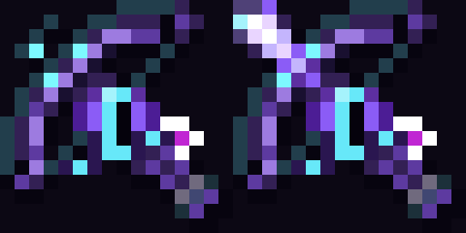

# Goety Arcana（诡厄奥术）

> **这是一个纯 AI 模组，请见谅。**
> 代码、贴图、配方、手册与文档全部由 AI 生成，没有人工美术或重构兜底；能跑、能玩、数值和手感正常是主要目标，
> 细节上（尤其是模型和贴图）难免粗糙。

一个 **Minecraft 1.20.1 / Forge 47.x** 的 [诡厄巫法（Goety）](https://www.mcmod.cn/class/7635.html) 附属模组。
定位是「Goety 的奥术扩展」：目前有虚空弩、虚空镰刀与一枚虚空系聚晶，后续还会继续加虚空系以外的东西。

**前置**：Forge 47.x、Goety 2.5.x（Curios、Patchouli 随 Goety 一起带入）。

| 虚空弩（空 / 已装填） | 虚空镰刀（常态 / 满蓄） |
| --- | --- |
|  |  |

| 虚空弩矢 | 裂魂聚晶 |
| --- | --- |
|  |  |

---

## 物品介绍

### 虚空弩（Void Crossbow）

远程虚空武器，把虚空的饥渴装进弩身。命中会累积「虚空之眼」，层数越高装填越快、箭越快。

**获取：末地仪式**

| 位置 | 物品 |
| --- | --- |
| 中央祭品 | 原版弩 |
| 外围 4 个 | 虚空之眼 ×2 + 虚空块 ×2 |
| 消耗 | 10 灵魂 / 5 秒 |

**虚空弩矢**

- 命中生物：给目标挂 4 秒「虚空爆炸」，到期在目标身上炸开；插在方块上则 4 秒后自行爆炸。
- 爆炸伤害 10 点，按距离衰减到三成。
- 合成：**1 个液态虚空瓶 + 1 支箭 → 1 支虚空弩矢**（工作台，无定型）。两格都能放整堆，每次各消耗 1 个。
- 物品图标是 16×16、8 帧动画。

**虚空之眼**

- 命中叠层，20 秒、最多 3 层，换下弩立刻消失。
- 每层装填时间 -20%、箭速 +20%；3 层时命中的弩矢附加流血（每秒 2 点，持续 6 秒）。
- 带层数且手持弩时，头顶会冒虚空紫火，层数越高火越旺。

**虚空长袍联动**

- 穿 Goety 的**虚空长袍**（Curios 饰品）时：弩矢自动追踪敌人，最多穿透 6 个目标，到达上限当场爆炸。
- 没有穿长袍时就是普通弩矢行为（命中挂虚空爆炸）。

**弹药规则**

- 只要身上还有虚空弩矢就只用弩矢；一支都没有时才退化成普通箭（任何箭类物品都能装填）。

---

### 虚空镰刀（Void Scythe）— WIP

> ⚠️ **模型和右键蓄力动画目前处于 WIP**，外观和蓄力表现还会改；**功能是正常的**，能正常横扫、蓄力放剑气、触发处决。

13 伤害 / 0.9 攻速的双手镰刀。

**左键：360° 横扫**

- 对周围 360°、半径 4.5 格内的所有合法敌人各结算一次伤害，背后的、侧面的都能打到。
- 有专属挥砍动作（第三人称双臂横扫 + 躯干扭转）。
- 命中时产生两层虚空火环，并给目标随机挂上虚空之蚀（70% I / 30% II），5% 概率挂处决。

**右键：双手蓄力，穿透剑气**

- 按住右键蓄力，松开释放；最少 5 tick、30 tick 蓄满。
- 沿准星生成一道向前飞行的横向剑气，**穿透生物、可穿墙**，持续 5 秒。
- 伤害是目标最大生命值百分比：最低 5%、满蓄 15%。

**处决（Execution）**

- 5 秒后结算，先播放专属处决动画（巨型虚空镰刀斩下）。
- 普通敌人直接消灭；精英怪损失 10% 最大生命值；Boss 损失 20% 最大生命值（可绕过 Boss 限伤）。
- 被处决致死的怪物有专属「虚空湮灭」死亡动画。

**获取：末地仪式**

| 位置 | 物品 |
| --- | --- |
| 中央祭品 | 黑暗镰刀（`goety:dark_metal_scythe`） |
| 外围 4 个 | 虚空回响 ×2 + 觉醒绿宝石 ×2 |
| 消耗 | 12 秒 / 每秒 5 灵魂 |

---

### 裂魂聚晶（Soul Burst Focus）

虚空系聚晶，射出一枚凝聚的虚空之弹。

- 伤害 = **固定 6 点 + 目标最大生命值 × 7.5%**，不受 Goety 的 Boss 伤害上限削减。
- 灵魂能量消耗 35，吟唱 10 tick，冷却 30 tick；虚空学派，任意法杖都能施放。
- 以**虚空魔杖**施放时额外：附加 5 秒虚空之蚀、夺走目标身上所有正面效果、命中点 3 格范围伤害；
  没打中敌人也会空爆（撞方块或飞到寿命尽头同样触发）。

---

### 荆棘藤缚（Bramble Bind）

荒野系聚晶。射出一颗带刺藤种，落地后成为等待陷阱。

- 种子插进土里后完全静止，并在 **3×3** 范围内持续侦测敌对生物；有目标靠近就破土缠住（单次施放最多 8 个，荒野魔杖 16 个）。
- 陷阱会在原地存活到时间结束（10 秒），期间**后续走进范围的敌人同样会被缠住**；每轮结束种子才消失。
- 被缠住的生物**完全无法移动、无法使用物品与技能**，精英与首领也不例外；藤蔓本身无敌，5 秒后缩回地下并消散。
- 藤上的**红刺**每秒对缠住的目标造成 2 点伤害。
- **荒野魔杖**施放：范围 7×7、缠绕 15 秒、最多缠 **16** 个目标；**荒野长袍**（Curios）再升级到 **9×9**（覆盖魔杖），并让缠绕附带**藤毒**。
- **藤毒**：持续时间和缠绕一致，每秒结算且伤害递增（1.0 + 0.75×秒数），无视护甲、抗性、附魔与无敌帧（结算前会清掉目标的受击无敌帧），亡灵和免疫负面效果的首领同样掉血；中毒期间**完全无法被治疗**（自然回血、药水、法术、Boss 自愈一律挡住）。
- 灵魂能量消耗 15，吟唱 3 秒，冷却 20 秒；**增生仪式**合成（祭品：缠绕聚晶；材料：2 毒刺藤种 + 增生之根 + 藤蔓；7 灵魂 / 13 秒）。

---

### 规划中的内容（尚未实装）

以下只有《黑暗秘典》里的设定文本，没有物品、模型、配方或机制：

- **虚空爆破聚晶**：召唤虚空苦力怕仆从，右键清除；
- **虚空护身符**：仅名称占位。

---

## 如何构建

需要 **JDK 17**。

```bash
gradle build
```

产物：`build/libs/goetyarcana-1.9.12.jar`，直接丢进 `mods/` 即可。

- Goety 依赖版本在 `gradle.properties` 的 `goety_version`（默认 `2.5.60.6`，Modrinth Maven）。
- 离线构建：把 `GRADLE_USER_HOME` 指向已缓存的 `.gradle-home/`，并加 `--offline -I <gradle-home>/local-repo.init.gradle`。
- 工程目录名是 `goety-soulburst`，属于历史遗留，mod id 仍是 `goetyarcana`。

---

## 更新日志

**1.9.12（测试中）**
- **荆棘藤缚**实装：荒野系聚晶，射出带刺藤种作为陷阱，3×3 侦测、命中后荆棘破土缠住目标 5 秒（不可移动、不可使用物品与技能，首领无豁免），红刺每秒 2 点伤害，藤蔓无敌并在结束时缩回消散；
- 荒野魔杖加成范围 7×7 / 缠绕 15 秒；荒野长袍加成范围 9×9 并附加**藤毒**（每秒递增、无视护甲与免疫，可致命）；
- 增生仪式配方（祭品：缠绕聚晶）；黑书新增对应条目；新增效果图标（方块人被藤缠 / 三颗毒滴）、荒野符文粒子、中毒生物头顶的绿色骷髅标记。

**1.9.11**
- 修复物品栏效果列表里虚空之眼图标**偏高 7 像素**的问题（原版图标画在行首 +7 的位置），图标与文字恢复对齐；
- 图标本身沿用 1.9.10 的三档设计，没有改动。

**1.9.10**
- 虚空之眼图标重画，并**按层数换图**：1 层眯眼、2 层半睁、3 层睁大带青光；HUD 与物品栏都已对齐到原版图标位置；
- 流血有了表现：中流血的目标身上会**滴下血滴**（自定义粒子，有重力、会落地），每秒再冒一个伤害指示；
- 物品 tooltip 改为世界观文本：弩、镰刀、弩矢、裂魂聚晶都不再写合成与数值，改成来源/故事；镰刀只保留一句模型 WIP 提示。

**1.9.9**
- 虚空弩的末地仪式时长从 30 秒缩短到 5 秒（灵魂消耗不变，仍是 10）。

**1.9.8**（虚空弩正式版）
- **虚空弩**实装：末地仪式合成（原版弩 + 2 虚空之眼 + 2 虚空块，10 灵魂 / 5 秒），弩身为 8 帧动画；装填后切换「已装填」模型并露出弩矢；
- 右键发射时喷紫色虚空火 + 烟火音效；
- **虚空之眼**层数：命中叠层（20 秒 / 最多 3 层），每层装填 -20%、箭速 +20%，3 层附加流血；带层数时头顶紫火按层数加量；
- **虚空弩矢**：命中挂 4 秒虚空爆炸 / 插地 4 秒后自爆；图标改为 16×16 八帧动画；
- 弹药规则：弩矢优先，没有弩矢时可打普通箭；弩矢由「1 液态虚空瓶 + 1 箭」合成；
- **虚空长袍**（Curios）联动：弩矢自动追踪、最多穿透 6 个目标后当场爆炸；
- 爆炸表现收敛（粒子更少更小、双环更细、整体抬高），贴脸不再糊屏；
- 《黑暗秘典》虚空弩条目改为正式内容，弩加了配方提示。

**1.9.7**
- 剑气改为横向刃面，起飞/消散做平滑加减速与淡入淡出；
- 被处决致死的怪物新增专属「虚空湮灭」死亡动画；
- 手册与文档补充规划内容的占位文本。

**1.9.6**
- 左键横扫粒子统一为自制虚空火双层环；
- 虚空镰刀新增末地仪式配方；
- 《黑暗秘典》新增「诡厄奥术」顶层分类。

**1.9.5**
- 镰刀模型融合第一版厚月牙与死神之镰的 32×32 紧凑尺寸；
- 透明像素改紫色 RGB，减轻光影黑边；
- 处决结算前增加巨型镰刀斩下动画。

**1.9.4**
- 镰刀模型以 Goety 死神之镰轮廓重绘，修复第一人称过大/怪异；
- 第一人称挥砍/蓄力动作幅度加大；
- 修复 `en_us.json` JSON 逗号错误。

**1.9.3**
- `@Shadow` 字段改用生产环境 SRG 名并 `remap = false`，绕开 Mixin 字段别名限制。

**1.9.2**
- 尝试用 `@Shadow` 别名修复 1.9.1，仍会启动崩溃。

**1.9.1**
- 修复 1.9.0 启动崩溃：改为注入 `HumanoidModel#setupAnim`。

**1.9.0**
- 镰刀专属挥砍/双手蓄力动作；剑气改为向前飞行、穿透、可穿墙；自制虚空火粒子。

**1.8.0**
- 新增虚空镰刀：13 伤害 / 0.9 攻速 / 360° 横扫、蓄力剑气、处决 debuff、新创造标签页。

**1.7.0 及以前**
- 虚空魔杖空爆、模组更名与 mod id 迁移、虚空方块射弹、聚晶标签页/末地仪式/Boss 限伤突破、初版裂魂聚晶。

---

## 更多文档

实现细节（工程结构、数值常量表、各处机制怎么写的、踩过的坑）都放在 **[IMPLEMENTATION.md](IMPLEMENTATION.md)**，
只想玩的话不需要看。

## 许可

MIT。
